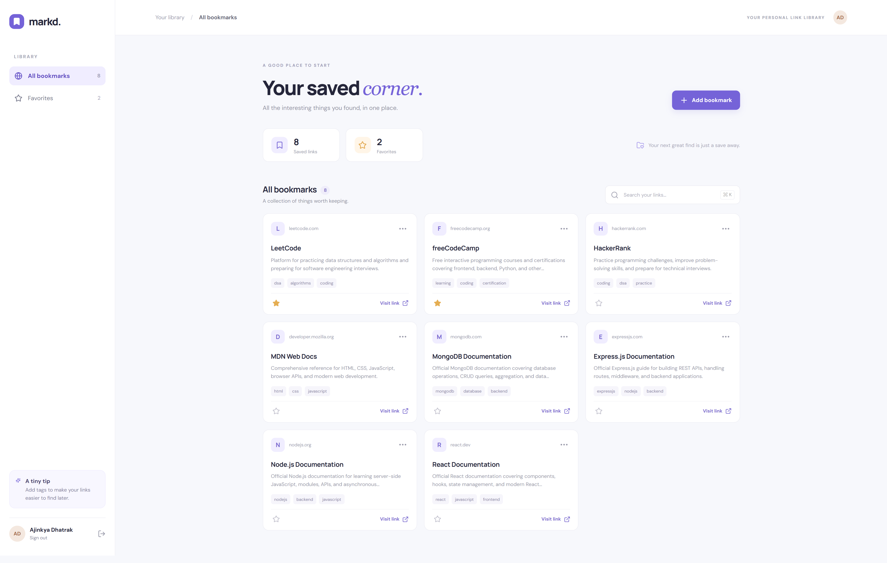
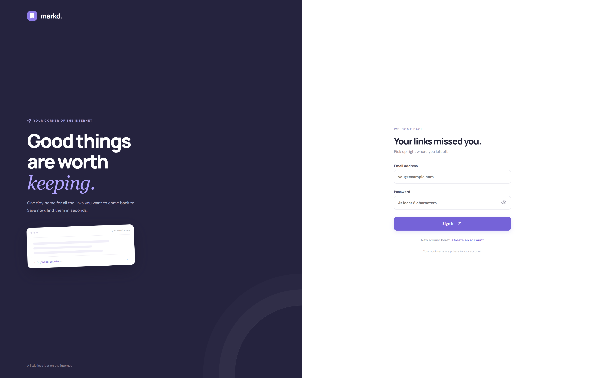
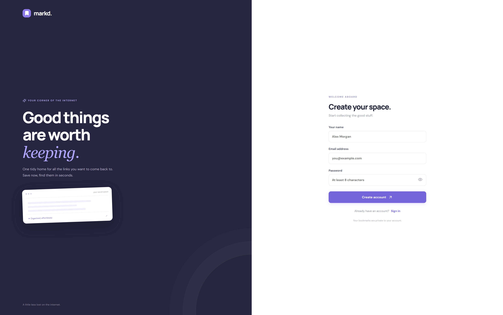
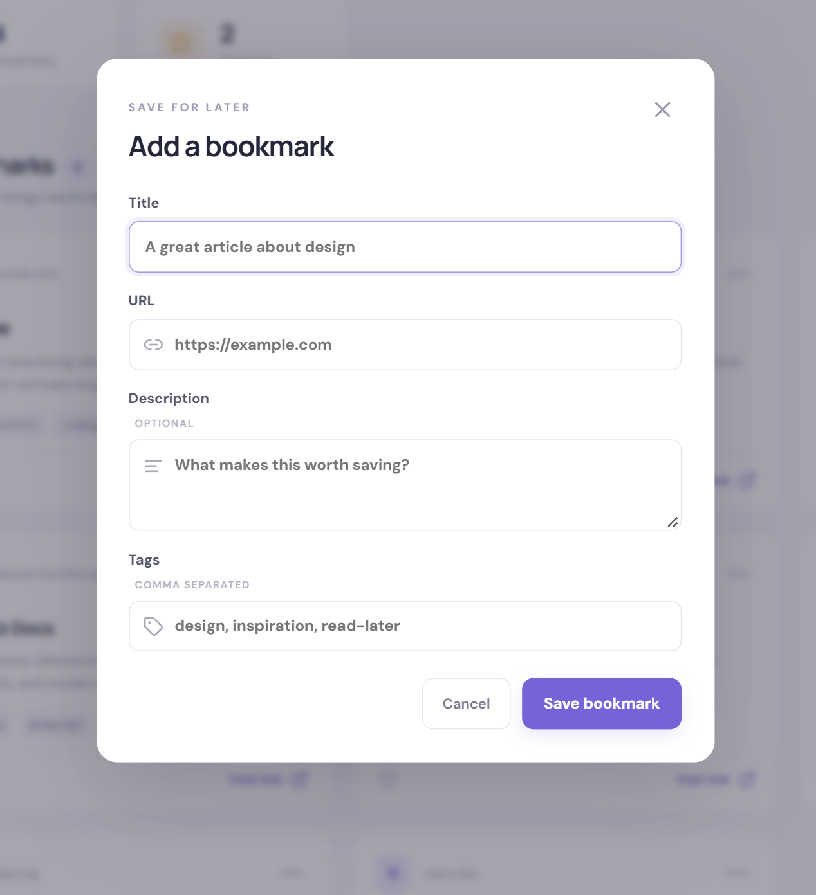

# 🔖 Bookmark Saver

A full-stack bookmark management application built using the **MERN Stack (MongoDB, Express.js, React.js, and Node.js)**. Bookmark Saver helps users save, organize, search, and manage their favorite website links in one convenient place.

<!-- Technology Badges -->
<p align="center">
  
  
  
  
  
  
  
</p>

---

## 📸 Screenshots

<!-- Replace the image paths below with your actual screenshots. -->

### Dashboard



### Login Page



### Register Page



### Add Bookmark



---

## ✨ Features

- **User Authentication:** Secure user registration and login using JWT authentication.
- **Add Bookmarks:** Save website links with titles, descriptions, and tags.
- **Edit Bookmarks:** Update existing bookmark details.
- **Delete Bookmarks:** Remove bookmarks you no longer need.
- **Favorites:** Mark important bookmarks as favorites for quick access.
- **Search Bookmarks:** Search saved links by title, URL, description, or tags.
- **Filter Bookmarks:** View all bookmarks or filter your favorite links.
- **Tag Management:** Organize bookmarks using custom tags.
- **Responsive Design:** Clean and responsive interface for different screen sizes.
- **Private Bookmarks:** Each user can access and manage only their own bookmarks.

## 🛠️ Technologies Used

### Frontend

- React.js
- Vite
- JavaScript (ES6+)
- CSS3
- React Router DOM
- Axios
- Lucide React Icons

### Backend

- Node.js
- Express.js
- MongoDB
- Mongoose
- JSON Web Token (JWT)
- bcryptjs

## 📁 Project Structure

```text
bookmark-saver-mern/
│
├── client/
│   ├── public/
│   ├── src/
│   │   ├── components/
│   │   │   └── BookmarkModal.jsx
│   │   ├── context/
│   │   │   └── AuthContext.jsx
│   │   ├── pages/
│   │   │   ├── AuthPage.jsx
│   │   │   └── Dashboard.jsx
│   │   ├── App.jsx
│   │   ├── api.js
│   │   ├── main.jsx
│   │   └── styles.css
│   ├── index.html
│   ├── package.json
│   └── vite.config.js
│
├── server/
│   ├── src/
│   │   ├── middleware/
│   │   │   └── auth.js
│   │   ├── models/
│   │   │   ├── Bookmark.js
│   │   │   └── User.js
│   │   ├── routes/
│   │   │   ├── auth.routes.js
│   │   │   └── bookmark.routes.js
│   │   ├── utils/
│   │   │   └── token.js
│   │   └── server.js
│   ├── .env.example
│   └── package.json
│
└── README.md
```

## ⚙️ Installation and Setup

### Prerequisites

Make sure you have the following installed:

- Node.js (v18 or above)
- npm
- MongoDB (local installation or MongoDB Atlas account)
- Git

### 1. Clone the Repository

```bash
git clone https://github.com/your-username/Bookmark-Saver.git
```

### 2. Navigate to the Project Directory

```bash
cd bookmark-saver-mern
```

### 3. Backend Setup

Navigate to the server directory:

```bash
cd server
```

Install dependencies:

```bash
npm install
```

Create a `.env` file in the server directory and configure the following environment variables:

```env
PORT=5000
MONGODB_URI=your_mongodb_connection_string
JWT_SECRET=your_secure_random_secret
CLIENT_URL=http://localhost:5173
```

Start the backend development server:

```bash
npm run dev
```

The backend API will run at:

```text
http://localhost:5000
```

### 4. Frontend Setup

Open another terminal and navigate to the client directory:

```bash
cd client
```

Install dependencies:

```bash
npm install
```

Optionally, create a `.env` file:

```env
VITE_API_URL=http://localhost:5000/api
```

Start the frontend development server:

```bash
npm run dev
```

Open your browser and visit:

```text
http://localhost:5173
```

## 🔗 API Endpoints

### Authentication Routes

| Method | Endpoint             | Description                |
| ------ | -------------------- | -------------------------- |
| POST   | `/api/auth/register` | Register a new user        |
| POST   | `/api/auth/login`    | Authenticate user          |
| GET    | `/api/auth/me`       | Get logged-in user details |

### Bookmark Routes

All bookmark routes require JWT authentication.

| Method | Endpoint             | Description       |
| ------ | -------------------- | ----------------- |
| GET    | `/api/bookmarks`     | Get all bookmarks |
| POST   | `/api/bookmarks`     | Create a bookmark |
| PUT    | `/api/bookmarks/:id` | Update a bookmark |
| DELETE | `/api/bookmarks/:id` | Delete a bookmark |

## 🔐 Authentication & Security

- JWT-based authentication.
- Password hashing using bcryptjs.
- Protected bookmark API routes.
- User-specific bookmark access.
- Token expiration after 7 days.
- Input validation for bookmark URLs and required fields.

## 🚀 Future Improvements

- Bookmark folders and collections.
- Automatic website previews and favicons.
- Browser extension for saving links.
- Import and export bookmarks.
- Dark mode.
- Password reset functionality.

## 👨‍💻 Author

**Ajinkya Dhatrak**

GitHub: [ajinkya029](https://github.com/ajinkya029)

---

⭐ If you find this project useful, consider giving it a star!
